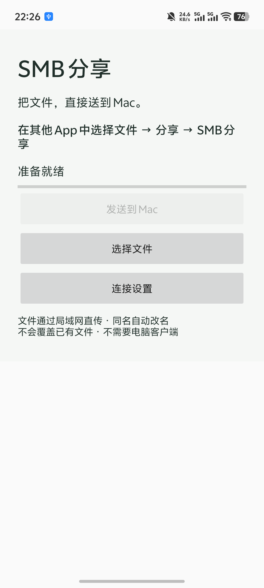
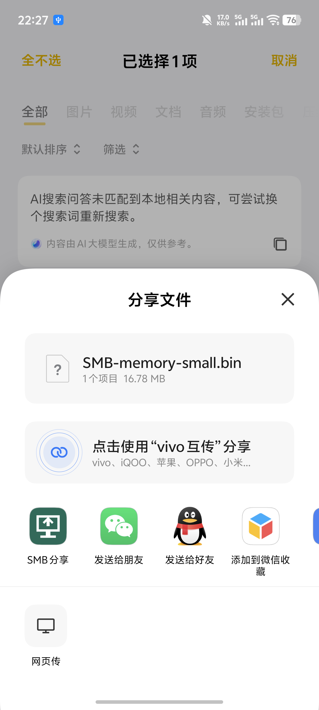
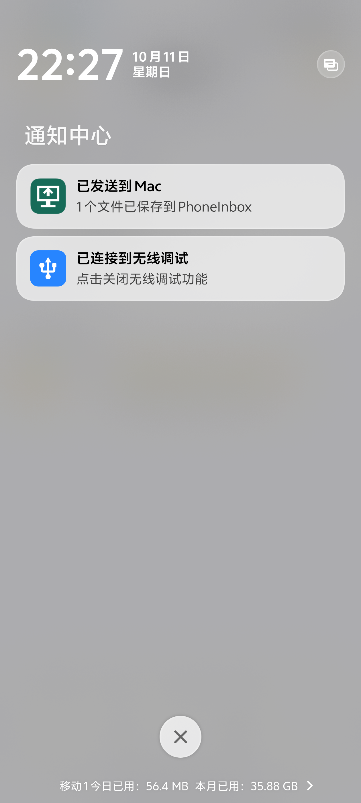
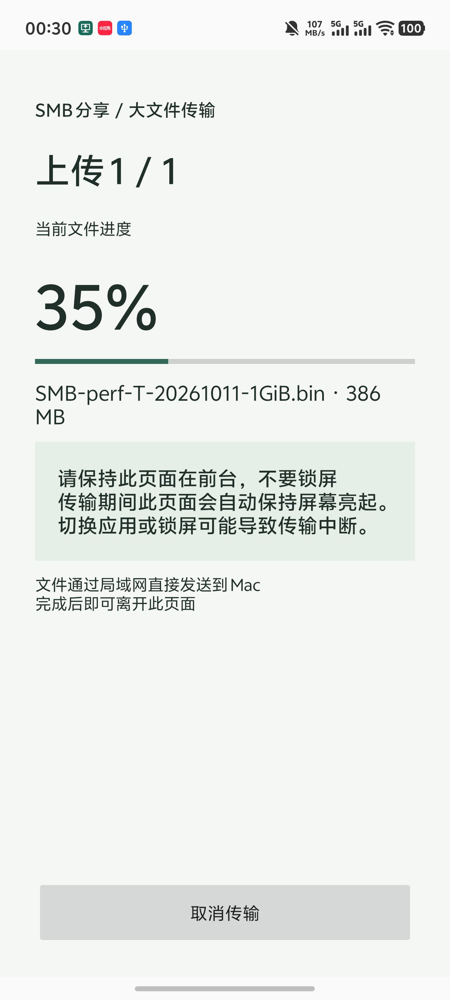

<div align="center">
  
  <h1>SMB Share · SMB 分享</h1>
  <p><strong>在 Android 分享菜单里点一下，把文件直接送到 Mac。</strong></p>
  <p>局域网直传 · 完成即通知 · 约 315 KiB · MIT 开源</p>
  <p><a href="https://smb.timmyagentic.si">项目官网</a> · <a href="https://smb.timmyagentic.si/downloads/SMB-Share-1.1.1.apk">下载 1.1.1 APK</a> · <a href="#快速开始">快速开始</a> · <a href="#已知限制">已知限制</a> · <a href="https://github.com/timmyagentic/smb-share/issues">反馈问题</a></p>
</div>

SMB Share 是一个轻量的原生 Android 分享接收器。首次配置好 Mac 共享文件夹后，在文件管理器或相册中选择文件，打开系统分享菜单并点 **「SMB 分享」**，就会自动开始上传，完成后发送系统通知。总大小达到 32 MiB 或文件大小未知时，会自动打开专用传输进度页；小文件保持后台分享。

文件通过 SMB2/3 在手机与目标共享服务器之间直接传输，无需电脑端客户端或云端中转。App 无广告、无分析 SDK，也不要求注册账户。

> **当前稳定版本：1.1.1。** 这是个人维护的早期项目。日常小文件分享已通过真机验证；部分手机系统会冻结长时间后台传输，详见[已知限制](#已知限制)。

## 交给 Agent 安装

> 请按 https://raw.githubusercontent.com/timmyagentic/smb-share/main/INSTALL.md 帮我安装并配置 SMB Share，校验正式 APK，保留已有手机配置、Mac 共享和文件；需要手机授权或密码时由我完成，最后从系统分享菜单传一个测试文件并在接收端核对大小和哈希，未完成步骤明确说明。

[完整 Agent 安装指南](INSTALL.md)说明可自动执行的步骤、手机授权和真实文件验收。

## 真实软件截图

以下图片直接截取自 **vivo V2502DA / Android 16 上的 1.0.0 实际应用与系统界面**，未经 AI 生成或重绘。分享面板和通知样式因手机而异。点击图片可查看原图。

<table>
  <tr>
    <th align="center">① 主界面</th>
    <th align="center">② 系统分享入口</th>
    <th align="center">③ 传输成功通知</th>
  </tr>
  <tr>
    <td align="center"><a href="website/assets/app-home.png"></a></td>
    <td align="center"><a href="website/assets/share-sheet.png"></a></td>
    <td align="center"><a href="website/assets/upload-done.png"></a></td>
  </tr>
  <tr>
    <td align="center">配置接收端，也可手动选文件</td>
    <td align="center">点一下，自动开始上传</td>
    <td align="center">保持在原应用，完成后通知</td>
  </tr>
</table>

大文件传输页（1.1.1 候选真机验收截图，与正式版使用同一上传实现）：



连接设置中的密码输入框默认隐藏，可选择显示。设置窗口启用了 Android 安全窗口标记，因此这里不展示该窗口的截图。

## 能做什么

| 功能 | 行为 |
| --- | --- |
| 系统分享入口 | 接收其他 App 分享的一个或多个文件；已完成配置时自动上传 |
| 后台传输与通知 | 使用前台服务展示传输状态，完成后显示成功或失败通知 |
| 同名文件保护 | 自动使用 `文件名 (1).扩展名` 等后缀，不覆盖已有文件 |
| 完成后再改名 | 先写入 `.smbshare-*.part`，成功后改为正式文件名 |
| 本地保存凭证 | 使用 Android Keystore AES-GCM 加密，密码不回填到设置输入框 |
| 手动选择与取消 | 可在主界面选择文件、发送到 Mac、取消当前传输 |
| 大文件进度页 | 32 MiB 起或大小未知时自动显示，传输期间保持亮屏；请保持前台 |
| 有界流水线上传 | 最多 1 MiB 分块、4 个在途请求，不将整个文件载入内存 |
| 轻量实现 | Java + Android 原生控件，无 WebView；APK 约 315 KiB |

## 安装

- 手机：**Android 9（API 28）或更新版本**。
- 接收端：已启用 SMB2/3 的共享文件夹；当前主要验证 macOS 文件共享。
- 网络：手机与接收端可通过局域网互相访问，目标 SMB 端口为 **445**。

**[下载 SMB Share 1.1.1 APK](https://smb.timmyagentic.si/downloads/SMB-Share-1.1.1.apk)**

安装时，Android 可能要求允许浏览器或文件管理器安装未知来源应用。首次使用请允许 App 的通知权限，以便查看上传结果。

可使用 [SHA256SUMS.txt](https://smb.timmyagentic.si/downloads/SHA256SUMS.txt) 核对下载文件：

```bash
shasum -a 256 SMB-Share-1.1.1.apk
```

当前 APK 是个人使用构建，使用开发签名，并非应用商店发行版。覆盖升级需使用相同签名；自行构建的 APK 可能无法直接覆盖官网构建。源码中的 `versionName` 是用户可见版本，`versionCode` 是持续递增的 Android 内部升级编号。

## 快速开始

### 1. 在 Mac 上开启共享

1. 打开 **系统设置 → 通用 → 共享**，启用「文件共享」。不同 macOS 版本的菜单位置可能略有差异。
2. 添加一个专门接收手机文件的文件夹，例如 `PhoneInbox`。
3. 在文件共享的「选项」中启用通过 SMB 共享文件，并允许用于连接的 Mac 账户。
4. 为该账户授予接收文件夹的读写权限。
5. 记下 Mac 当前的局域网 IP、共享名称和账户短用户名。

Mac 应保持唤醒，并与手机处于能够互访的网络；访客 Wi-Fi 或启用了设备隔离的无线网络可能阻止连接。

### 2. 在手机上配置接收端

打开 App → **连接设置**，填写：

| 字段 | 填写内容 |
| --- | --- |
| Mac 地址 | Mac 的局域网 IPv4 地址；不要包含 `smb://`、路径或端口 |
| 共享名称 | SMB 共享名称，例如 `PhoneInbox`；不是 Mac 上的完整文件夹路径 |
| 用户名 | 获准使用 SMB 的 Mac 账户短用户名 |
| Mac 登录密码 | 该账户的登录密码，不是 Apple 账户密码 |

保存后即可开始分享。再次编辑设置时，密码留空会保留已保存密码；勾选「显示密码」只影响本次输入的可见性。关闭窗口会清空未保存的输入。

### 3. 从其他 App 分享文件

1. 在文件管理器或相册中选中一个或多个文件。
2. 打开系统分享菜单，选择 **SMB 分享**。
3. 配置和通知权限齐备时，上传会自动开始，无需再点「发送到 Mac」。
4. 大文件自动打开传输进度页，请保持前台、不要锁屏；小文件可留在原应用等待通知。
5. 确认 **「传输完成」** 或 **「已发送到 Mac」** 通知，再到共享文件夹查看结果。

首次使用时可能先进入配置或权限界面。已有传输尚未结束时，新分享会加入队列。

如果从 SMB Share 主界面点「选择文件」，则需要再点「发送到 Mac」。需要中止时，可在主界面点「取消传输」。

## 权限与数据

- **网络权限**：连接指定的 SMB 服务器。
- **前台服务与通知权限**：显示传输过程和结果。
- **文件访问**：仅使用你通过系统文件选择器或分享操作授予的 `content://` 读取权限，不请求整个存储空间访问权。
- **连接凭证**：保存在手机本地，使用 Android Keystore 加密；不上传至项目官网。
- **备份与截图**：关闭 Android 应用备份；包含密码的设置窗口禁止截屏。
- **传输安全**：使用标准 SMB2/3 协商。请只连接可信局域网和服务器；本项目不保证每个服务器连接都强制启用 SMB 传输加密。

官网只提供项目介绍、源码链接和安装包，不参与文件传输。

## 已知限制

### 大文件性能

1.1.1 使用最多 1 MiB 分块、4 个有界在途分块、平台 AES-CMAC 实现（不支持时回退到原实现），并按写入大小预留独立序列化缓冲。小文件按大小缩减缓冲，所有写入得到确认后才重命名为最终文件。

2026-10-11 至 2026-10-12，在 vivo V2502DA / Android 16、充电和前台亮屏、Mac 千兆有线口的同一系统分享链路中，256 MiB 从约 25.4 秒降到约 2.8–3.2 秒；1 GiB 两次约 9.49–9.66 秒，SHA-256 一致。这是指定设备与局域网的实测，不代表所有环境速度。保持服务器要求的 SMB 签名。4 MiB 是应用数据缓冲上限，整个进程还会占用库、界面及临时对象内存。

性能数值来自同一上传实现的诊断构建内部计时，包含连接认证。去除诊断的候选 APK 也完成了 1 GiB 哈希验证，外部轮询约 10.54 秒确认结束；该观察时间包含采样延迟。完整方法与边界见 [性能说明](docs/performance.md)。

构建验证：`./gradlew :app:assembleRelease :app:testReleaseUnitTest :app:lintRelease`。真机密码学自检构建需额外使用 `-PcryptoTest=true :app:assembleReleaseAndroidTest`，安装对应主 APK 与测试 APK 后运行 `adb shell am instrument -w local.smbshare.test/local.smbshare.CryptoInstrumentation`。

### 长时间后台传输

目前在 vivo Android 16 上，**16 MiB 文件的实际后台分享、文件 SHA-256 和完成通知已验证通过**。但 **128 MiB 长传输曾被厂商系统冻结，恢复前台后失败**。这一问题尚未解决，不能把小文件测试视作任意大小文件都能可靠后台传输。

从系统分享接收总大小达到 **32 MiB** 的文件（或大小未知的文件）时，会自动打开专用进度页，显示当前文件进度、成功或失败状态。请保持该页面在前台，不要锁屏；页面在传输期间自动保持亮屏，完成、失败或取消后解除。返回键会提醒离开页面的风险；Home 键、手动锁屏和系统切换仍可能中断传输。

其他品牌、Android 版本及厂商省电策略尚未完整验证。大文件传输请确认接收端文件完整，并以成功状态为准。

### 其他边界

- 目前只配置一个目标共享根目录，不提供多服务器列表或子目录选择。
- 支持 SMB2/3，不支持 SMB1；不支持域账户配置、自定义端口、IPv6 地址输入。
- **没有断点续传**。应用内保留最近 8 个批次的有限重试状态；进程结束后不会自动恢复。重新从外部 App 分享会生成新批次。
- 取消、断网或进程终止后，可能遗留 `.smbshare-*.part` 临时文件。这些文件尚未完成，不能当作成功结果。
- 当前以 Mac 为主要验证目标，Windows、NAS 和不同 SMB 服务器没有完成完整兼容性测试。
- 本项目不修改 Android 系统分享菜单的排序。

## 常见问题

### 分享菜单中找不到「SMB 分享」？

确认安装已完成，并尝试从文件管理器分享一个实际文件。App 接收文件分享，不接收纯文本消息或网页链接。部分系统会把入口放在「更多」中。

### 提示连接或传输失败？

先检查 Mac 是否唤醒、手机与 Mac 是否能互访，再检查 IP、共享名称、账户密码、SMB 账户授权和目标目录读写权限。Mac 的 IP 可能随网络重连变化。成功打开端口不等于成功上传文件。

### 为什么没有收到完成通知？

检查系统是否允许 SMB Share 发送通知，以及是否对该应用启用了额外的通知或后台限制。失败通知会提示进入应用检查设置，再重新分享文件。

### 同名文件会被覆盖吗？

不会。App 会自动添加数字后缀。重复从外部分享同一个文件可能产生副本，这是避免覆盖的预期行为。

### 能从互联网远程传回家里吗？

当前目标是可信局域网中的文件传输，不提供公网穿透或远程访问配置。不要为使用本 App 直接把 SMB 端口暴露到公网。

### 怎么确认收到的是完整文件？

先确认收到成功通知。重要文件可进一步对比源文件和 Mac 上文件的 SHA-256。共享目录中的 `.part` 文件表示未完成。

## 从源码构建

需要 **JDK 17**、**Android SDK Platform 36**。仓库自带 Gradle 8.14.3 Wrapper。

```bash
git clone https://github.com/timmyagentic/smb-share.git
cd smb-share

# 使用本机 Android SDK 路径
export ANDROID_HOME="$HOME/Library/Android/sdk"

./gradlew :app:assembleRelease :app:testReleaseUnitTest :app:lintRelease
```

也可通过本地 `local.properties` 中的 `sdk.dir` 指定 SDK 路径，该文件不会进入 Git。

输出 APK：

```text
app/build/outputs/apk/release/app-release.apk
```

安装到已连接的设备：

```bash
adb install -r app/build/outputs/apk/release/app-release.apk
```

当前 release 构建使用本机 Android debug keystore 签名。项目不提交签名密钥；若用于正式分发，请自行配置和妥善保存签名密钥。

## 项目结构

```text
app/src/main/java/local/smbshare/
├── MainActivity.java   # 主界面与连接设置
├── ShareActivity.java  # 系统分享入口，按文件大小选择界面
├── TransferActivity.java # 大文件进度与亮屏提示
├── WindowedUploader.java # 有界在途请求、确认与取消
├── UploadService.java  # 队列、SMB 上传、取消及通知
├── Vault.java          # 本地凭证加密
├── Names.java          # 文件名清理与同名处理
└── RetryHistory.java   # 有界批次进度记录
app/src/test/           # 文件名、重试、窗口、签名与序列化单元测试
website/                # 官网、真实截图、1.1.1 下载与校验值
```

## 官网开发

官网是 `website/` 下的静态 HTML、CSS 和 JavaScript，不依赖前端框架。

```bash
# 本地预览
python3 -m http.server 8787 --directory website

# 准备部署目录（需要 Node.js）
node scripts/build-website.mjs
```

当前官网通过 Cloudflare Worker 的精确域名路由发布，保持原 DNS 和下载路径；验证、部署及回退见 [官网说明](website/README.md)。上面的历史构建命令仍可输出被 Git 忽略的 `dist/`，Cloudflare 直接使用 `website/`。官网图片来自真机截图；请勿提交包含个人信息的截图或签名密钥。

## 验证与参与

现有 24 项单元测试覆盖文件名与重试记录、分享页面策略、服务器限制、在途缓冲生命周期、写入确认、取消/超时、签名回退与序列化一致性。真机验证还需检查分享授权、SMB 认证、文件内容一致性、取消/失败和通知行为。

欢迎提交 Issue 或 Pull Request。报告问题时，请附上手机型号、Android 版本、接收端系统、文件大小和复现步骤；请去除密码、个人文件内容以及截图中的私人信息。

## 许可证与依赖

本项目采用 [MIT License](LICENSE)。

- [SMBJ](https://github.com/hierynomus/smbj) 0.15.0：SMB2/3 客户端，Apache-2.0。
- [SLF4J](https://www.slf4j.org/) NOP 2.0.17：无日志输出实现，MIT。
- Bouncy Castle 等传递依赖保留各自许可证。构建仅保留 SMBJ 实际使用的加密算法和资源。

---

**English:** SMB Share is a small native Android share target that uploads selected files directly to a Mac or SMB2/3 share on your local network. Configure the destination once, choose “SMB 分享” in the system share sheet, and receive a notification when the upload completes. No desktop companion or cloud relay is required. Version 1.1.1 uses bounded four-request pipelining for large files. Shares of 32 MiB or unknown size open a progress page that keeps the screen awake; keep this page in the foreground. Android 9+, MIT licensed. Long-running background transfers are not yet reliable on some OEM devices; see the limitations above before use.
