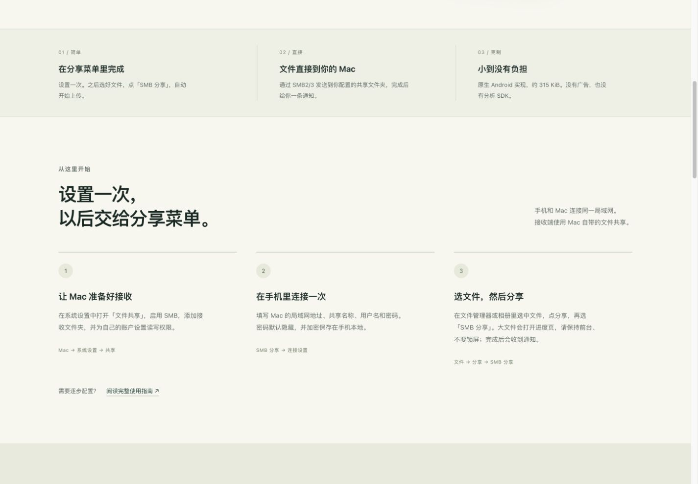
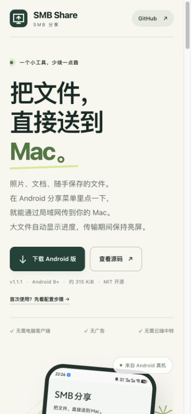

# SMB Share mobile installation QA — 2026-10-25

The website and README now lead users through downloading the Android APK on their phone, configuring the receiving share, and sharing a first file. The Agent installation section, prompt, clipboard handler and unused styles are removed. INSTALL.md is a phone-first user guide.

Verified locally at 1440 × 1000 and 390 × 844: no Agent installation section or horizontal overflow; direct APK links and the first-use configuration anchor; desktop QR loading; screenshot dialog opening, Escape dismissal and focus restoration; all visible images loaded. The full guide links to INSTALL.md.

JavaScript syntax, local asset/anchor references, whitespace checks and Wrangler dry run passed. Both existing APKs and SHA256SUMS.txt retain their original SHA-256 values. This change does not rebuild the Android app. Device installation and actual SMB transfer were not rerun (UNVERIFIED for this website change).

These are unmodified browser captures of the candidate. Production verification is recorded separately after deployment.

